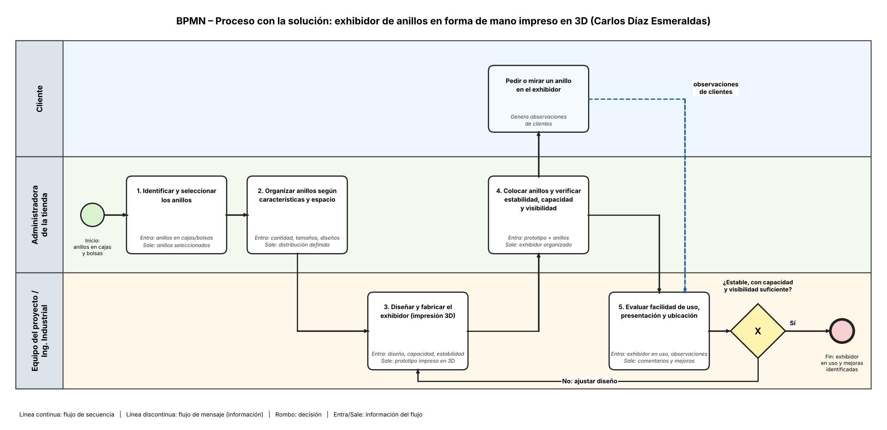

# 06 · Solución y flujo de información 
## Solución propuesta 
**Qué cambia en el proceso con la solución (máximo 5 líneas):** 
Se implementará un exhibidor de anillos con forma de mano, elaborado mediante impresión 3D. 
Los anillos dejarán de almacenarse únicamente en cajas y bolsas sueltas. 
La administradora podrá organizar y exhibir los productos de manera ordenada y visible. 
Se busca reducir el tiempo de búsqueda y mejorar la presentación de los anillos. 
La solución facilitará la atención al cliente y disminuirá el riesgo de pérdida de productos. 
## Flujo de información 
 
| Paso | Entrada (qué información llega) | Proceso (qué se hace) | Responsable (quién) | Salida (qué información sale) | 
|---|---|---|---|---| 
| 1 | Anillos almacenados en cajas y bolsas; necesidades de exhibición. | Identificar y seleccionar los anillos que se van a organizar. | Administradora de la tienda | Anillos seleccionados para exhibición. | 
| 2 | Cantidad, tamaños y diseños de los anillos. | Organizar los anillos según sus características y espacio disponible. | Administradora de la tienda | Distribución definida para el exhibidor. | 
| 3 | Diseño del exhibidor y requerimientos de capacidad y estabilidad. | Diseñar y fabricar el exhibidor mediante impresión 3D. | Equipo del proyecto / Ingeniería Industrial | Prototipo de exhibidor de anillos impreso en 3D. | 
| 4 | Prototipo fabricado y anillos seleccionados. | Colocar los anillos y verificar estabilidad, capacidad y visibilidad. | Administradora de la tienda | Exhibidor organizado y listo para utilizarse. | 
| 5 | Exhibidor en uso y observaciones de la administradora y clientes. | Evaluar facilidad de uso, presentación y ubicación de los anillos; identificar mejoras. | Equipo del proyecto y administradora | Comentarios, resultados de prueba y propuestas de mejora. | 
## Antes y después 
| Proceso actual | Proceso con la solución | 
|---|---| 
| Los anillos se guardan en cajas y bolsas sueltas. | Los anillos se organizan en un exhibidor impreso en 3D. | 
| La administradora debe buscar los anillos entre diferentes recipientes. | Los anillos se encuentran visibles y organizados en un solo lugar. | 
| La exhibición depende de acomodar manualmente los productos sobre el mostrador. | El exhibidor permite presentar los anillos de forma ordenada y atractiva. | 
| Existe riesgo de desorden y pérdida de productos. | Se busca mejorar el control visual y reducir el riesgo de pérdida. | 
| La búsqueda puede generar demoras en la atención. | Se espera facilitar la ubicación de los anillos y agilizar la atención. | 
