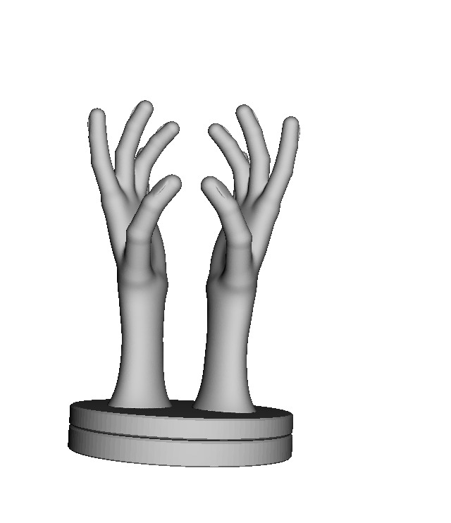

# 07 · Prototipo
## Hipótesis del prototipo
| | |
|---|---|
| **Qué vamos a construir** | Un modelo 3D exhibidor de joyería |
| **Tipo de prototipo** | Prototipo 3D |
| **Usuario** | Administrador de la tienda |
**Hipótesis**
> Creemos que el administrador de la tienda podrá organizar, almacenar y exhibir los anillos de manera más ordenada y atractiva mediante un joyero en forma de mano impreso en 3D, reduciendo el desorden y facilitando la búsqueda de los productos.
**Sabremos que es cierto si:** durante una semana de prueba, el administrador logra encuentrar las piezas con mayor facilidad y mejora su exhibición en el punto de venta.
## Versión 0.1
**Qué tiene la v0.1:**
1. Estructura en forma de mano diseñada para sostener y organizar los anillos.
2. Soportes en los dedos para colocar los anillos de manera visible y ordenada.
3. Base de apoyo rotatoria que permita mantener el joyero estable sobre el mostrador.

**Evidencia:**

